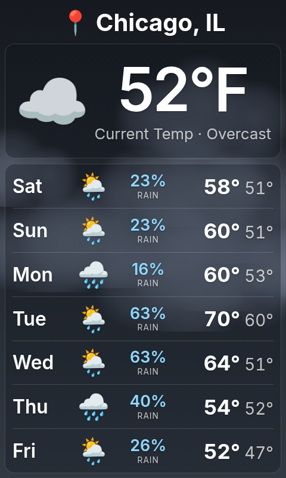
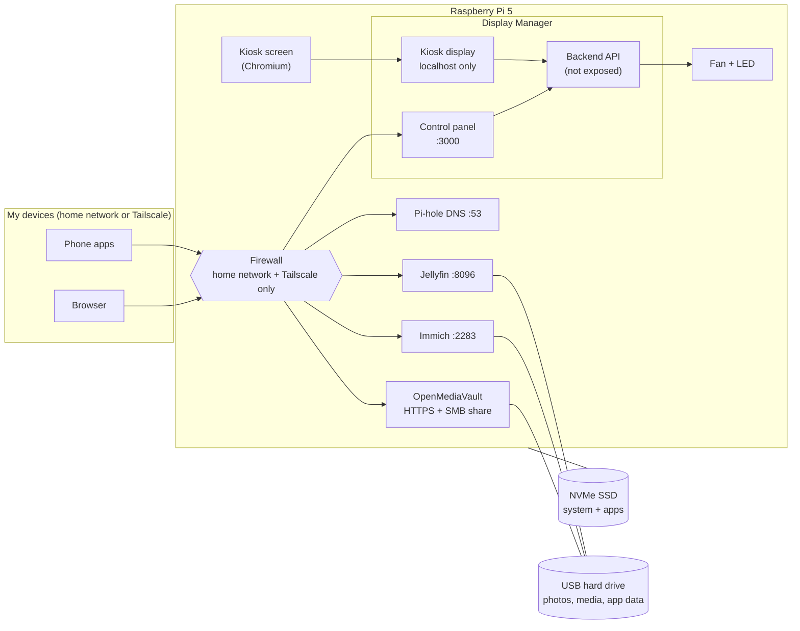

# pi5-homelab

Everything that runs on my Raspberry Pi 5 home server, in one place: the
apps I built, the self-hosted services, the Pi's own setup and the security
hardening. It's written so I can rebuild the whole system on a new Pi by
following [docs/rebuild.md](docs/rebuild.md) from top to bottom.

<p align="center">
  
  
</p>

## Highlights

**[Pi Display Manager](apps/display-manager/)** is the project I built for
this Pi: a 480×800 kiosk screen (an iPhone-style clock over my photos, the
weather, or a GIF) plus a web control panel for the screen, the fan, an RGB
LED, drive health and the Pi itself. FastAPI backend, two React front ends,
Docker.

The rest of the Pi is a small NAS and media server: photo backup (Immich),
streaming (Jellyfin), network-wide ad blocking (Pi-hole), all on a drive
managed by OpenMediaVault and reachable only at home or over Tailscale.

## Hardware

| Part | What I use |
|---|---|
| Board | Raspberry Pi 5, 8 GB |
| System drive | Crucial P3 500 GB NVMe SSD on a Pimoroni NVMe Base |
| Data drive | WD Elements Portable 500 GB (2.5" 5400 rpm) over USB |
| Display | Waveshare 3.5" HDMI LCD, driven at 800×480 and rotated to portrait |
| Cooling | 4-pin PWM fan on GPIO 18, speed set from the control panel |
| Light | One WS2812 RGB LED on SPI0 (GPIO 10) |
| OS | Raspberry Pi OS (Debian 13 "trixie"), 64-bit |

Wiring and boot settings: [docs/hardware.md](docs/hardware.md).

## How it fits together



More detail: [docs/architecture.md](docs/architecture.md).

## Services

| Service | What for | Port | Folder |
|---|---|---|---|
| Pi Display Manager | Kiosk screen + control panel (my project) | 3000 | [apps/display-manager](apps/display-manager/) |
| Immich | Photo and video backup from my phones | 2283 | [services/immich](services/immich/) |
| Jellyfin | Movies and shows | 8096 | [services/jellyfin](services/jellyfin/) |
| Pi-hole | Ad and tracker blocking for the whole network | 53, 8081 | [services/pihole](services/pihole/) |
| Portainer | Looking after Docker containers | 9443 (HTTPS) | [services/portainer](services/portainer/) |
| OpenMediaVault | The data drive and network share | 443 (HTTPS), 445 | [host/omv](host/omv/) |

Every container image is pinned to an exact version; I upgrade on purpose,
not by accident.

## Security

- **Reachable only at home and over Tailscale.** A host firewall drops
  everything else, for IPv4 and IPv6, including Docker's published ports.
  Nothing is forwarded from the internet.
- **SSH:** keys only, no root login.
- **Least privilege:** no container runs privileged. The display manager's
  backend isn't on the network at all; its control panel needs a login, and
  reboot/shutdown go through a tiny host helper that can do only those two
  things.
- **HTTPS** for the admin pages that control the system (OpenMediaVault, Portainer).
- **Drive health** is monitored (SMART) with weekly self-tests.
- **No secrets or personal details in this repo.** They live in local
  `.env` files; a pre-commit check and a GitHub check block anything private.

Details: [docs/security.md](docs/security.md).

## Repo layout

```
apps/            things I built (Pi Display Manager)
services/        third-party stacks: compose files and setup notes, no data
host/            the Pi's own setup: boot config, OMV, firewall, kiosk, helpers
scripts/         deploy, dev, private-info check, hardware tests
docs/            rebuild guide, hardware, architecture, storage, security, publishing rules
```

## What isn't here

Passwords, addresses, my location, drive IDs, folder names, photos and
media all stay on the Pi. Each app and service has a `.env.example` showing
what to fill in. The rules are in [docs/publishing-rules.md](docs/publishing-rules.md).
