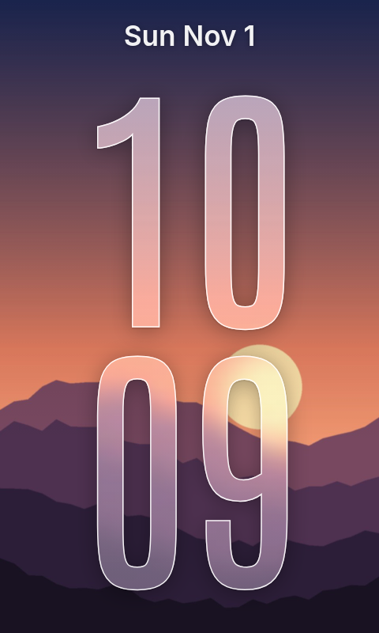
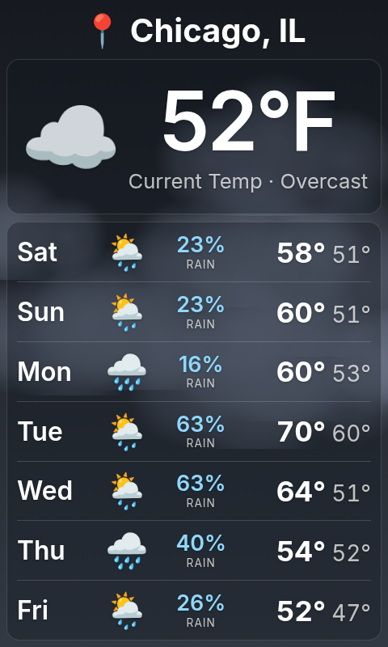
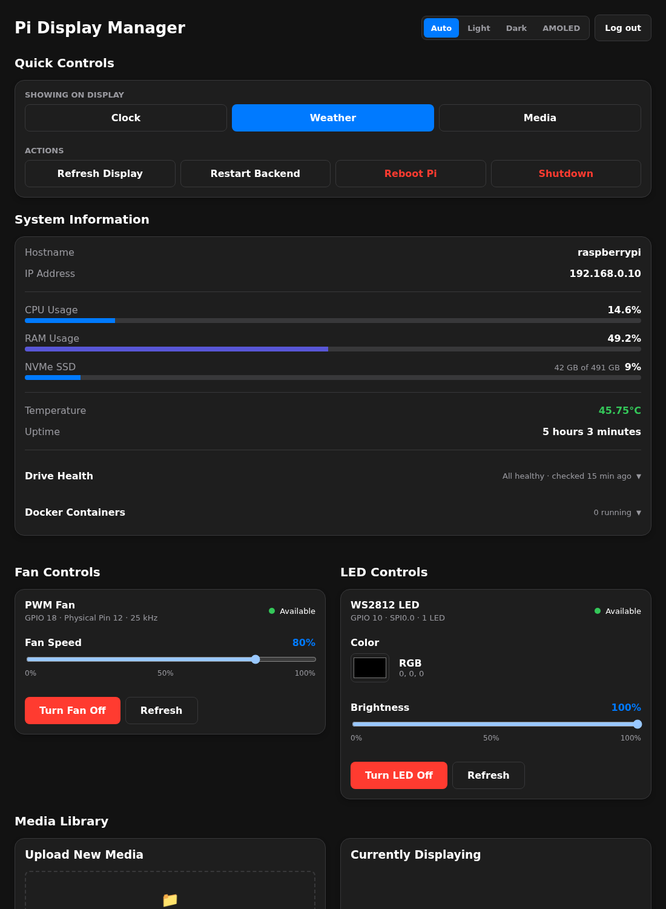

# Pi Display Manager

A kiosk screen for my Raspberry Pi and a web control panel to run it.

The Pi has a small 800×480 screen mounted in portrait. It shows an
iPhone-lock-screen-style clock over my photos at night, the weather during
the day, or a GIF, and switches between them on a schedule. The control
panel, open in any browser at home, picks the screen and photo, uploads
media, sets the fan and RGB LED, and shows the Pi's health.

<p align="center">
  
  &nbsp;
  
</p>
<p align="center">
  
</p>

<sub>Screenshots use sample data.</sub>

## Features

**On the screen**
- **Clock:** hours stacked above minutes as large as the screen allows,
  in tall frosted-glass digits over a photo. The digit colour adapts to
  each photo (light or dark, tinted from the photo, chosen per row) so the
  time stays readable on bright skies and dark scenes alike.
- **Photos:** a slideshow that changes every 10 minutes, or one chosen
  photo. iPhone HEIC photos work; each is resized, rotated and cached for
  the screen.
- **Weather:** current conditions and a 7-day forecast from Open-Meteo,
  over an animated sky that matches the weather (stars at night, rain,
  snow, fog, lightning).
- **Media:** any GIF, image or video from the library.
- **Schedule:** clock at 11 PM, weather at noon; manual changes win until
  the next switch.

**In the control panel**
- Switch screens; refresh the display; restart the app; reboot or shut down
  the Pi (with a confirm tap).
- System information: CPU, memory, temperature, uptime, usage per drive.
- **Drive health** from SMART: status, temperature, hours, bad sectors or
  wear, last self-test.
- Docker container list.
- Fan speed and LED colour/brightness.
- Media library and clock photo uploads (including straight from an iPhone).
- Light, dark, AMOLED, or follow the device.

## How it's built

| Part | Tech |
|---|---|
| [`backend/`](backend/) | Python 3.12, FastAPI, Pillow (+ HEIF), psutil |
| [`display/`](display/) | React 19 + Vite, served by nginx; the kiosk page |
| [`frontend/`](frontend/) | React 19 + Vite, served by nginx; the control panel |
| Hardware | Fan via the kernel's PWM interface, WS2812 LED over SPI |

```
backend/app/
  main.py       builds the app, wires routes and startup
  settings.py   every setting, read from .env
  auth.py       panel login, sessions, the display's restricted key
  state.py      what survives a restart (screen, photo mode, fan, LED)
  hardware.py   fan PWM and WS2812 LED, with a simulated mode for dev
  schedule.py   daily screen switching
  routes/       screen, system, hardware, media, clock, weather
```

The interactive API reference is served at `/api/docs` once logged in.

### Security

- The backend isn't published on the network. The panel's and the kiosk's
  nginx forward `/api` to it internally.
- The panel requires a login (scrypt-hashed password, HttpOnly SameSite
  cookie). Changes also need an `X-Requested-With` header, so other
  websites can't drive it through my browser.
- The kiosk is reachable only from the Pi itself and uses a shared key that
  allows read-only calls only.
- No privileged containers: the backend gets the fan's `/sys` files and the
  LED's SPI device. It lists containers through a proxy that allows only
  that one read.
- Reboot and shutdown go through a host helper that can do nothing else
  ([`host/display-manager-power/`](../../host/display-manager-power/)).
  Drive health comes from a host job
  ([`host/drive-health/`](../../host/drive-health/)), since the app can't
  read drives itself.
- Uploads are checked by content, not file name, and file names can't
  escape their folder.

## Running it

```sh
cp .env.example .env            # fill in; DISPLAY_KEY: openssl rand -hex 24
../../scripts/deploy.sh display-manager
sudo ../../host/display-manager-power/install.sh
sudo ../../host/drive-health/install.sh
docker logs display-manager-backend | grep "setup code"   # first login
```

Open `http://<pi>:3000`, enter the setup code, choose a password.

### Settings (`.env`)

| Variable | Meaning |
|---|---|
| `TZ` | Time zone for the schedule and weather |
| `PI_HOSTNAME`, `PI_ADDRESS` | Shown in System Information |
| `DATA_DISK` | Where the data drive is mounted (for its usage bar) |
| `WEATHER_LATITUDE`, `WEATHER_LONGITUDE`, `WEATHER_LOCATION_NAME`, `WEATHER_UNITS` | Weather screen |
| `SCREEN_SCHEDULE` | e.g. `23:00=clock,12:00=weather` |
| `DISPLAY_KEY` | Shared secret between the kiosk's web server and the backend |
| `PANEL_PORT` | Control panel port (default 3000) |
