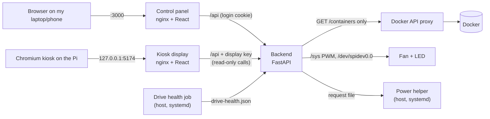

# Architecture

## Network

Nothing on the Pi is reachable from the internet. My devices reach it on
the home network or over Tailscale, and the host firewall
([`host/firewall/`](../host/firewall/)) drops everything else, for IPv4 and
IPv6. Docker's published ports are covered too: Docker forwards those to
containers instead of delivering them to the Pi, so the firewall has a
matching rule in its `forward` chain.

The only automatic router rule is Tailscale's own direct-connection port
(UDP 41641), which Tailscale opens itself; traffic on it is encrypted
WireGuard.

## Pi Display Manager

- **Two web servers, one API.** The backend isn't published on the network.
  The control panel's nginx and the kiosk's nginx each forward `/api` to it
  over Docker's internal network, so the browser only ever talks to the page
  it loaded (no cross-origin requests, no CORS).
- **The panel needs a login**, kept in an HttpOnly, SameSite=Strict cookie.
  Requests that change something must carry `X-Requested-With`, which
  other websites can't add, so a page elsewhere can't use my session.
- **The kiosk has a key, not a login.** Its nginx adds a shared secret
  header; with it the backend allows only the read-only calls the display
  needs. The kiosk port is bound to 127.0.0.1, so only the Pi's own browser
  can use it.
- **No privileged containers.** The backend gets the fan's `/sys` files and
  the LED's SPI device, nothing else. It lists containers through a proxy
  that only allows `GET /containers`.
- **Host actions go through tiny helpers.** Reboot and Shutdown drop a file
  into `data/host-requests/`; a systemd path unit on the Pi runs a script
  that can only reboot or power off. Drive health goes the other way: a
  root timer reads SMART and writes a JSON file the backend serves.

## Kiosk boot sequence

1. The Pi boots to a console and logs my user in automatically on tty1.
2. `~/.profile` runs `startx` (tty1 only; never over SSH).
3. [`xinitrc`](../host/kiosk/xinitrc) disables blanking, rotates the panel
   to portrait and opens Chromium full screen at `http://localhost:5174`.
4. The page asks the backend every 3 seconds which screen to show, and
   reloads itself when a new version is deployed.

If Chromium or X ever exits, the login session ends, the console logs in
again, and the kiosk restarts.

## Screen schedule

The backend switches the screen at set times (`SCREEN_SCHEDULE` in
`.env`): the clock at 11 PM, the weather at noon. It only acts at those
moments, so I can still switch screens by hand in between.
